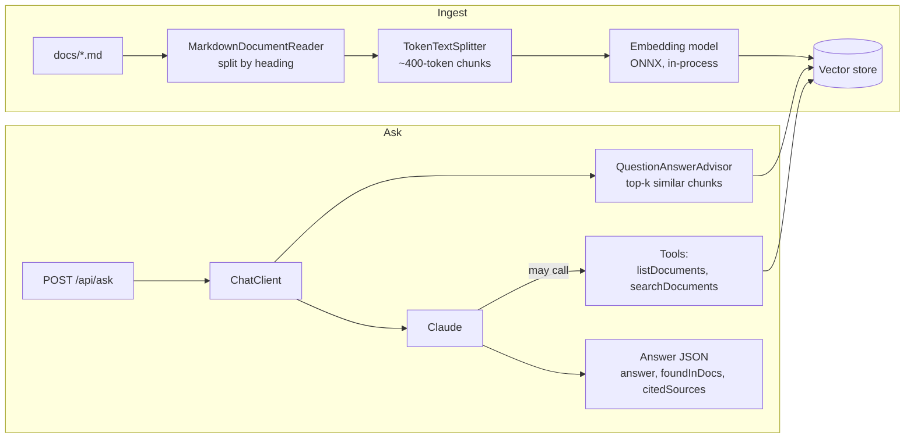

# Spring AI Docs Assistant

Ask questions about your own documentation and get answers grounded in it, with the sources each answer came
from. Built with **Spring Boot 3.5**, **Java 21** and **Spring AI 1.1**, using Claude as the chat model.

It shows the main building blocks of a Spring AI application:

| Building block | Spring AI piece | Where |
| --- | --- | --- |
| Chat with an LLM | `ChatClient` over the Anthropic starter | `config/AiConfig.java` |
| Read and chunk documents | `MarkdownDocumentReader`, `TokenTextSplitter` | `ingest/IngestionService.java` |
| Embeddings | Transformers (ONNX `all-MiniLM-L6-v2`), runs inside the JVM | `application.yml` |
| Vector store | `SimpleVectorStore` (file-backed) or `PgVectorStore` | `config/VectorStoreConfig.java`, `application-pgvector.yml` |
| Retrieval-augmented generation | `QuestionAnswerAdvisor` | `config/AiConfig.java` |
| Tool calling | `@Tool` methods the model can call | `tools/DocsTools.java` |
| Structured output | `.responseEntity(Answer.class)` | `ask/AskService.java` |

## How it works



1. **Ingest.** Each Markdown file is split by heading, long sections are split again into ~400-token chunks, and
   every chunk is embedded and stored with its file name and section title. Re-ingesting a file deletes its old
   chunks first (a metadata filter on `source`), so editing a document and re-ingesting replaces it instead of
   duplicating it.
2. **Ask.** The `QuestionAnswerAdvisor` finds the chunks most similar to the question and adds them to the prompt.
   If they are not enough, the model can call `searchDocuments` to search again with other words or inside one
   document, or `listDocuments` to see what exists. The reply is mapped onto a Java record, and the chunks that
   were retrieved are returned alongside it so every answer can be checked against its sources.

## Run it

You need Java 21 and an Anthropic API key. Nothing else: the embedding model runs inside the JVM and the default
vector store is a JSON file.

```bash
export ANTHROPIC_API_KEY=sk-ant-...
./mvnw spring-boot:run        # or: mvn spring-boot:run
```

The first start downloads the embedding model (about 90 MB) and indexes `docs/`. Then:

```bash
curl -s localhost:8080/api/ask -H 'Content-Type: application/json' \
  -d '{"question": "How do I verify a webhook signature?"}'
```

The response has this shape (illustrative; the wording and scores will differ):

```json
{
  "answer": "Compute an HMAC-SHA256 of `<timestamp>.<raw body>` with the endpoint's signing secret and compare it with the v1 value in the Northwind-Signature header using a constant-time comparison. Reject timestamps older than five minutes, and always use the raw body bytes.",
  "foundInDocs": true,
  "citedSources": ["webhooks.md"],
  "retrieved": [{ "source": "webhooks.md", "section": "Verifying signatures", "score": 0.71 }],
  "model": "claude-opus-5-5"
}
```

Other endpoints:

| Endpoint | What it does |
| --- | --- |
| `GET /api/search?q=...&source=...` | Vector search only, no model call. Shows what retrieval finds for a question. |
| `GET /api/documents` | The ingested files with their chunk counts and section titles |
| `POST /api/ingest` | Re-read `docs/` after editing files |

The sample documents describe a fictional payments API. Replace the files in `docs/` with your own Markdown, or set
`DOCS_DIR` to another folder.

### With PostgreSQL + pgvector

```bash
docker compose up -d
mvn spring-boot:run -Dspring-boot.run.profiles=pgvector
```

The `pgvector` profile turns on the DataSource and Spring AI's `PgVectorStore` (HNSW index, cosine distance,
384 dimensions to match the embedding model) and turns off the file-backed store. No code changes: both are
`VectorStore`, which is the point of the abstraction.

## Configuration

| Property | Default | Meaning |
| --- | --- | --- |
| `ANTHROPIC_API_KEY` | | Your Anthropic key |
| `ANTHROPIC_MODEL` | `claude-opus-5-5` | Any Claude model id |
| `DOCS_DIR` | `docs` | Folder of Markdown files |
| `assistant.top-k` | `4` | Chunks the advisor adds to the prompt |
| `assistant.min-similarity` | `0.35` | Chunks less similar than this are left out |
| `assistant.chunk-tokens` | `400` | Target chunk size |
| `VECTOR_STORE_FILE` | `data/vector-store.json` | Where the default store is saved |

## Design notes

- **Embeddings run locally.** Anthropic does not offer an embedding model, so a second provider would otherwise be
  needed. The ONNX model needs no key, costs nothing per call, and keeps documents on the machine during indexing.
  The trade-off is quality: a hosted embedding model would retrieve better on large or specialised corpora, and
  switching is one starter and one property.
- **The advisor retrieves, the tools let the model look again.** Plain RAG runs one search with the user's words.
  When the question uses different words from the docs, the first search can miss; giving the model a search tool
  lets it rephrase and retry within the same request. Both tools only read.
- **Answers are structured and sourced.** The model must return `answer`, `foundInDocs` and `citedSources`, and the
  response also carries the chunks that were actually retrieved, so a client can show sources and flag answers
  the documentation did not support.
- **Documents are data, not instructions.** The system prompt tells the model to answer only from the context and
  to treat document text as data, and the threshold keeps unrelated chunks out of the prompt. This reduces, but
  does not remove, the risk of prompt injection through a malicious document.
- **No sampling parameters.** Spring AI sends a default `temperature` to Anthropic, which current Claude models
  reject; `AiConfig` clears it so requests carry only the model and `max_tokens`.

## Project layout

```
src/main/java/io/github/abinesh1006/docsassistant/
├── api/          REST endpoints and error mapping
├── ask/          AskService: one ChatClient call → structured answer + sources
├── config/       ChatClient, vector store, properties
├── ingest/       Markdown → chunks → embeddings → vector store
└── tools/        @Tool methods the model can call
docs/             sample documentation (fictional)
```

## Ideas to extend it

- Chat memory (`MessageChatMemoryAdvisor`) for follow-up questions
- Streaming answers with `.stream()` and server-sent events
- An evaluation set: questions with expected sources, scored with Spring AI's `RelevancyEvaluator`
- Hybrid retrieval: combine keyword search with vector search for exact terms such as error codes
